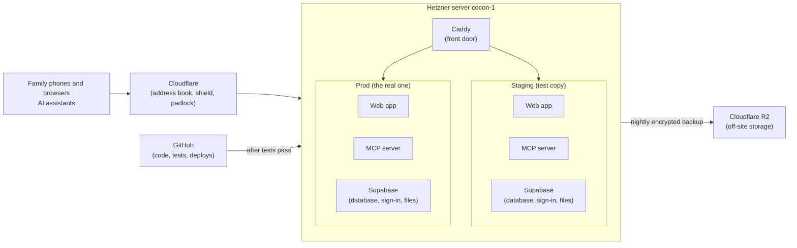

# How Our Cocon runs on the internet

This guide explains, in plain words, where the app runs, how a change gets from your computer to the family's phones, and what is left to set up. It's written for Gabriel, who knows the product but is new to servers. The last section, [Technical notes for Claude](#technical-notes-for-claude), is the precise to-do list a Claude Code session works from.

Keep this file current: whenever the setup changes, update it in the same pull request.

---

## The big picture

- **One rented computer** at Hetzner, called `cocon-1`, runs everything. It's in a data centre and is always on.
- It runs **two complete copies** of Our Cocon:
  - **Staging**: a test copy. Every change lands here first, so you can try it safely.
  - **Prod**: the real app the family uses. It only gets a change when you approve a release.
- **Cloudflare** sits in front of the server. It points `app.ourcocon.com` at the server, encrypts the connection (the padlock), and blocks attacks. Visitors never talk to the server directly.
- **GitHub** holds the code. When you merge a change, GitHub runs the tests, builds the app and installs it on the server by itself. Nobody logs into the server to deploy.

### The web addresses

| Address | What it is | Who uses it |
| --- | --- | --- |
| `app.ourcocon.com` | The app | The family |
| `mcp.ourcocon.com` | Where AI assistants connect | Claude, ChatGPT, Gemini |
| `api.ourcocon.com` | Supabase: data, sign-in, photos | The app, behind the scenes |
| `studio.ourcocon.com` | Supabase's admin screens | Only you, after a Cloudflare PIN check |
| Same with `-staging` (`app-staging.ourcocon.com`, …) | The test copy | You, to try changes |

---

## Words you'll meet

| Word | What it means here |
| --- | --- |
| **Server** | The rented computer at Hetzner (`cocon-1`). Ubuntu Linux, 4 processors, 8 GB of memory. |
| **SSH** | A secure way to type commands on the server from your Mac. It uses a **key**: a pair of files, one private (stays on your Mac, never shared) and one public (given to the server). |
| **Docker / container** | A way to run each piece of software in its own sealed box with everything it needs. The box is a **container**. The recipe it starts from is an **image**. |
| **Docker Compose** | A file listing several containers that run together, like the parts of Supabase. |
| **Supabase** | The database, sign-in and photo storage the app uses. We run the free, open-source version ourselves ("self-hosted") instead of paying for Supabase Cloud. |
| **Caddy** | The server's front door. It receives every request and passes it to the right container (app, MCP or Supabase, staging or prod). |
| **Origin certificate** | A file from Cloudflare that proves to Cloudflare it's really talking to our server. It lives on the server. |
| **Cloudflare Access** | A PIN check by email in front of the admin screens (Studio), so only you can open them. |
| **CI** (GitHub Actions) | GitHub's robots. On every change they run the checks, and after a merge they build and deploy. |
| **GHCR** | GitHub's storage for the built images. The server downloads them from there. |
| **Deploy** | Installing a new version on the server. |
| **Migration** | A file that changes the database's structure (for example, adding a table). Each one runs once, in order. |
| **Secret** | A password or key (database password, email key, …). Never in the code, never in a chat. |
| **`deploy` user** | The account GitHub uses on the server. It's only allowed to run the deploy and restore-test commands. |
| **R2** | Cloudflare's file storage, used for backups in a different place from the server. |
| **Swap** | Disk space the server uses as extra memory in an emergency. |

---

## What's already done

**By you (spec 001's "Needs your attention"):**
- **Cloudflare:**
  - DNS records for all 8 addresses
  - SSL on Full (strict)
  - the origin certificate
  - Access in front of Studio
  - the R2 bucket `cocon-backups`
  - email routing
- **Resend:** email sending from `ourcocon.com`, used for sign-in links.
- **Hetzner:**
  - the server `cocon-1`, with Hetzner's own backups
  - a firewall: SSH open but only with a key; web traffic only from Cloudflare
- **GitHub:** the `staging` and `production` environments with the server's SSH details. Production requires your approval.

**In the code** (branch `001-project-scaffold`, tested):
- the project structure
- the app's placeholder page with a build footer
- the MCP server's health check
- the database migration runner (if one migration fails, none are applied)
- the three images GitHub will build: web app, MCP server, migrations

---

## What's left, in order

Each phase says **who does what**, and **how we know it worked**.

### Phase A: Claude writes the server setup (nothing touches the server yet)

Claude writes these files in the repo. You review them in the pull request.

| Piece | What it does, in plain words |
| --- | --- |
| **Provisioning script** (`infra/provision.sh`) | A one-time setup you run from your Mac. It does six things: <ul><li>Installs Docker on the server.</li><li>Creates the `deploy` user for GitHub.</li><li>Turns on automatic security updates and adds swap.</li><li>Locks down logins: keys only, no root login.</li><li>Sets up both copies of Supabase and the front door.</li><li>Asks you for each secret at a hidden prompt.</li></ul> You can run it again safely: it only does what's missing, and it can rebuild the server from scratch. |
| **Deploy command** (`cocon-deploy`) | What GitHub runs on the server for each release:<ol><li>Download the new version.</li><li>Update the database.</li><li>Switch to the new version.</li><li>Check it answers.</li></ol>If any step fails, the previous version keeps running. |
| **Supabase setup per copy** | Uses Supabase's official release (pinned to a known version). Staging is trimmed to save memory. |
| **Front door** (Caddy) | Routes each address to the right container, and refuses anything that isn't meant to be public. |
| **Nightly backups** | Every night: <ul><li>A full database copy (including accounts) and the photos.</li><li>Encrypted with a key only you hold.</li><li>Sent to R2 and kept 30 days.</li></ul> |
| **Monthly restore test** | Once a month, GitHub restores the latest prod backup into staging and checks that everything is there. A backup you've never restored is a guess. |
| **Alerts** | An email to `hello@ourcocon.com` if the disk is nearly full or memory runs low. An outside service emails you if a site stops answering. |
| **GitHub workflows** | Three robots: <ul><li>**Checks** on every change.</li><li>**Deploy to staging** after a merge.</li><li>**Release to prod** when you approve.</li></ul> |
| **Local tools** | `pnpm dev` and `pnpm check` work on your Mac, plus the move-to-Supabase-Cloud guide. |

**How we know it worked:** `pnpm check` passes, and two automatic reviews pass: the security reviewer and the spec reviewer.

### Phase B: you prepare a few accounts and keys (Claude guides you, click by click)

Nothing here goes into the chat. You save each result in your password manager.

1. **The backup key.**
   - On your Mac, a tool called `age` makes a key pair.
   - The *public* half goes to the server, so it can lock backups.
   - The *private* half goes only in your password manager. It's the only way to open a backup, so if it's lost, the backups are useless.
2. **PostHog.** Two projects, "Our Cocon staging" and "Our Cocon prod", each with its own project key. They count app opens. They never see names or recipes.
3. **Uptime monitoring.** A free UptimeRobot account that checks each address every few minutes and emails you if one is down.
4. **Your SSH key on this Mac.** Check that your Mac can log into `cocon-1`. Claude helps add your Mac's key if it can't.

### Phase C: set up the server (you run it, Claude guides you)

1. From your Mac, you run the provisioning script against `cocon-1`.
2. It asks for each secret in turn. You paste each one from your password manager; nothing shows on screen.
3. It ends by checking that the `deploy` user can log in, **before** it switches off root login, so you can't lock yourself out.

**How we know it worked:** these addresses answer; the app addresses show "not deployed yet" until Phase D.
- `https://studio-staging.ourcocon.com` asks for the Cloudflare PIN, then the Studio login.
- `https://api-staging.ourcocon.com/auth/v1/health` answers.

**If something goes wrong:** Hetzner keeps daily backups of the whole server, and the script can rebuild everything. Nothing here is permanent.

### Phase D: first deploy to staging, then prod

1. You merge the spec 001 pull request.
2. GitHub tests, builds and deploys to staging by itself, in under 10 minutes.
3. Open `https://app-staging.ourcocon.com`. The footer shows **Build** and the first 7 characters of the commit. That's the proof the right version is live.
4. To release to prod, create a release tag on GitHub (Claude shows you how). GitHub asks for your approval, then installs **the exact same build** on prod.
5. After the first prod release, you turn on two settings:
   - **HSTS** in Cloudflare. It tells browsers to always use the padlock.
   - **Branch protection** on `main` in GitHub. Nothing merges unless the checks pass.

### Phase E: what happens from then on

**Automatic:**
- security updates on the server
- nightly backups
- the monthly restore test
- memory, disk and uptime alerts by email

**Occasionally, by you (with Claude's help):**
- **Read alert emails.** Most mean "add space" or "restart something".
- **Update Supabase** every month or two. One command, on staging first, then prod.
- **If the server gets too small:** Hetzner can give it more memory in a few minutes, and you can scale back later.

**When to move to Supabase Cloud:** when running Supabase yourself takes more than an hour or two a month, or a restore test fails. The steps will be in `docs/move-to-supabase-cloud.md`. The app works either way, because every address and key is a setting.

---

## Safety rules

- **Claude never has access to the server.** It writes scripts; you run the one-time setup; GitHub runs deploys.
- **Secrets never go in the code or the chat.** You type them at hidden prompts on the server. There they're stored encrypted, and only unlocked in memory while needed.
- **Nothing is public that doesn't need to be.** The database and the admin screens can't be reached from the internet directly. Only Cloudflare can reach the server's web ports.
- **Every risky step has a way back:**
  - a failed deploy leaves the old version running
  - a failed database change is undone automatically
  - the server has Hetzner backups and a rebuild script

---

## Does the server have enough power?

Probably yes, with room to spare. The tight resource is memory, not processor power, and these are estimates until we measure on the server with `docker stats`.

| Part | Approx. memory |
| --- | --- |
| One Supabase copy | 1.5–2.5 GB |
| Supabase log analytics (optional) | +0.5–1 GB |
| Web app + MCP server, per copy | 0.1–0.2 GB |
| Caddy, Ubuntu, Docker | ~0.5 GB |
| **Both copies** | **about 4–6.5 GB of 8 GB** |

**Recommended, to confirm with Gabriel:** leave out of both copies the parts we don't use:
- log analytics (Logflare and Vector)
- the connection pooler (Supavisor)

That saves about 1–1.5 GB. Edge Functions and Studio on staging can go too, if needed later.

---

## Technical notes for Claude

The remaining spec 001 work. Decisions already made are listed first: follow them, don't relitigate. Explain each step to Gabriel as this guide does, guide anything he does himself click by click, and verify results from the outside (URLs, CI logs) where you can.

### Decisions made
- **Versions:**
  - Pinned to releases that pass pnpm's release-age check. Never add `minimumReleaseAgeExclude`; pin older patches instead.
  - TypeScript 6.0, because typescript-eslint doesn't support 7.
  - Expo SDK 57; expo-router 57.0.26.
- **App tests** use Vitest with `@testing-library/react` on react-native-web, because RNTL can't load react-native under Vitest. Log this as a deviation in the Changelog.
- **Runtime config:**
  - One web build serves both environments. `infra/web/write-config.sh` writes `/config.js` (`window.__COCON__`) when the container starts, and refuses bad values.
  - `/version.json` carries the commit.
  - `DebugFooter` is hidden on prod.
- **Images:**
  - `ghcr.io/gabdeum/our-cocon-{web,mcp,migrate}:<sha>`, built for `linux/amd64` in CI.
  - The migrate image carries `supabase/migrations` and `scripts/migrate.ts`, bundled with esbuild.
  - The server only receives `<env> <sha>`; everything it runs comes from CI-built images.
- **MCP:** bundled with esbuild, with `@opentelemetry/api` external.
- **Supabase:**
  - Self-hosted from tag `self-hosted/v0.8.2` of supabase/supabase `docker/`. Use its `setup.sh` flow, `utils/generate-keys.sh --update-env` and `utils/add-new-auth-keys.sh --update-env` for secrets, and `update.sh` for upgrades.
  - The gateway is Envoy. Analytics is the optional `docker-compose.logs.yml`.
- **Per-environment override file** (`infra/supabase/cocon.override.yml`):
  - `container_name: !reset null` on every service, so two stacks don't collide.
  - A network alias `realtime-dev.supabase-realtime` on `realtime`, because Envoy's `cds.yaml` addresses it by that name.
  - `ports: !reset []` on the gateway and pooler.
  - The gateway joins the external network `cocon-edge` with the alias `<env>-api`.
  - `COMPOSE_PROJECT_NAME=cocon-<env>`, set in the stack's `.env`.
  - Staging also disables imgproxy via `profiles`, and storage gets `depends_on: !override` without imgproxy and `ENABLE_IMAGE_TRANSFORMATION=false`.
  - Pending Gabriel's confirmation: no logs override and no supavisor in either environment.
- **Secrets:**
  - Each environment's Supabase `.env` and app env are sealed with `systemd-creds` (`/etc/cocon/creds/`).
  - `cocon-secrets unlock <env>` decrypts them to `/run/cocon/<env>/` (tmpfs, root, 0600). The stack's `.env` is a symlink to that file.
  - `cocon-supabase-update <env> <tag>` must unlock, give `update.sh` a real `.env` file (its `sed -i` breaks symlinks), re-seal, restore the symlink, then pull and recreate.
- **Edge:**
  - One Caddy container on `cocon-edge`, publishing 80/443, with the Cloudflare origin certificate (also sealed).
  - `app[-staging]` → `<env>-web:8080`; `mcp[-staging]` → `<env>-mcp:8787`.
  - `api[-staging]` → `<env>-api:8000`, **only** for `/auth/v1/`, `/rest/v1/`, `/realtime/v1/`, `/storage/v1/`, `/graphql/v1` and `/.well-known/oauth-authorization-server`; 404 for everything else (Studio, `/pg/`, `/mcp`).
  - `studio[-staging]` → `<env>-api:8000`, all paths (Supabase basic auth behind Cloudflare Access).
  - HSTS and security headers on every host.
  - The domain comes from `COCON_DOMAIN` in `infra/config.env`.
- **`deploy` user:** not in the docker group. sudoers allows only `/usr/local/bin/cocon-deploy` and `/usr/local/bin/cocon-restore-test`, with argument checks (`env` ∈ staging|prod, `sha` = 40 hex characters).
- **`cocon-deploy <env> <sha>`:**
  1. Pull all three images; on failure, stop.
  2. Run the migrate image on `cocon-<env>_default` with `DATABASE_URL=postgres://postgres:…@db:5432/postgres`; on failure, stop.
  3. `docker compose up -d` the app compose (`infra/app/compose.yml`) with the new tags.
  4. Poll `<env>-web/version.json` and `<env>-mcp/health` for the sha for 60 s; if they don't show it, switch back to the previous tags from `/srv/cocon/<env>/current` and exit 1.
- **Migrations:** `scripts/migrate.ts` (tested). One transaction plus an advisory lock; records to `supabase_migrations.schema_migrations`.

### Still to do
1. **`infra/`:**
   - `config.env`
   - `provision.sh`, run from the Mac via `infra/bootstrap-from-laptop.sh <host>` (rsync + `ssh -t`). Idempotent, with `--dry-run`. It sets up:
     - the `deploy` user with `cocon-deploy.pub`
     - Docker
     - 4 GB swap
     - `unattended-upgrades`
     - ufw (22, plus 80/443 from Cloudflare ranges)
     - sshd hardening, last, after checking that `deploy` can log in
   - `bin/` scripts: `cocon-deploy`, `cocon-secrets`, `cocon-stack`, `cocon-backup`, `cocon-restore-test`, `cocon-healthcheck`, `cocon-supabase-update`
   - Supabase overrides, the app compose file, and the Caddy compose file and Caddyfile
   - systemd units and timers: stacks at boot, nightly backup per environment, 5-minute health check
   - `infra/tests/deploy.test.ts`: `cocon-deploy` with stubbed `docker`/`curl` on `PATH`, covering a failed pull, a failed migration, and a failed health check that rolls back
   - shellcheck clean
2. **Backups:**
   - `pg_dumpall`, encrypted with `age` to Gabriel's public key, sent with rclone to `cocon-backups/<env>/db/`.
   - Storage goes through an rclone crypt remote to `<env>/storage/`.
   - Each backup carries a manifest of row and object counts.
   - Anything older than 30 days is pruned.
   - The restore test restores the latest prod backup into staging and compares it with the manifest.
3. **Alerts:** `cocon-healthcheck` emails through the Resend API when disk use is over 80%, memory over 90% or swap is heavily used. UptimeRobot monitors 6 URLs (Gabriel sets them up).
4. **`.github/workflows/`:**
   - `ci.yml`:
     - On every push and PR: install, lint, typecheck, `supabase start` then `test:all`, `pnpm audit --audit-level high`, gitleaks, actionlint, shellcheck.
     - On `main` only: build and push the images; `deploy-staging` (environment `staging`) runs SSH `sudo cocon-deploy staging $SHA`; a smoke step checks the sha on `app-staging…/version.json` and `mcp-staging…/health`.
     - A concurrency group, so deploys don't overlap.
   - `release.yml`: on `v*` tags, environment `production`; checks the images exist for the tag's commit, adds the version tag to the same digest, deploys prod, runs the smoke checks.
   - `restore-test.yml`: monthly cron, plus run by hand.
5. **Local:**
   - `scripts/check.mjs` (changed packages vs `origin/main`, counting uncommitted changes; root config changes mean all packages)
   - `scripts/theme.mjs` stub (the real one is spec 002)
   - `pnpm dev` creates `.env.local` from `env.example` plus `supabase status -o env` when it's missing
   - `env.example` with every variable
   - README with one-command setup
6. **Docs:** `docs/move-to-supabase-cloud.md` (FR-002c). Keep this guide current, adding the runbook commands as they're written.
7. **Finish:**
   - `pnpm check` and `pnpm test:all` (against local Supabase on the Mac)
   - the `security-reviewer` and `reviewer` subagents
   - a Changelog line in `specs/001-project-scaffold/spec.md`, with deviations: theme stub, bare `Text` footer, the app test library, Supabase trimming
   - the PR `001 Project scaffold and environments`, listing `app_opened` and Phases B–D as "Needs your attention"
